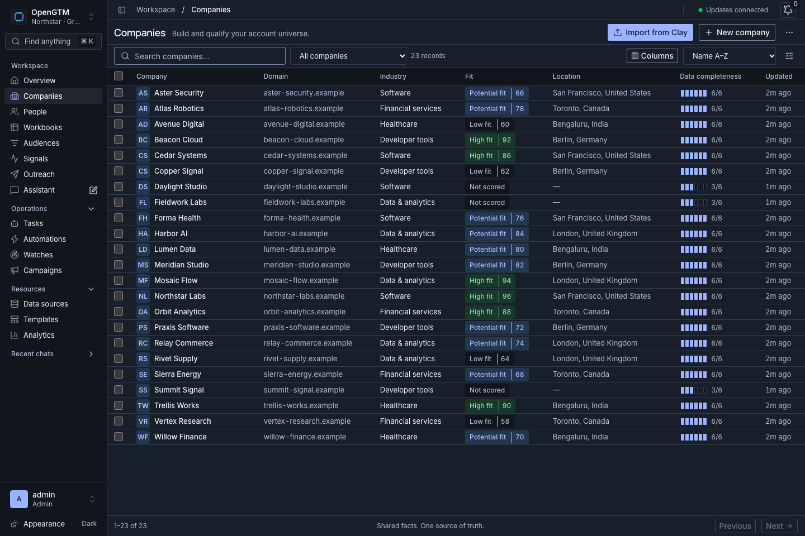

<p align="center"></p>
<h1 align="center">OpenGTM</h1>
<p align="center">An open-source, self-hosted workspace for GTM teams and their agents.</p>
<p align="center">
  <a href="https://opengtm.palash.dev">Docs</a> ·
  <a href="#run-it">Install</a> ·
  <a href="#co-maintainer-wanted">Co-maintainer wanted</a> ·
  <a href="https://github.com/debpalash/OpenGTM/releases">Releases</a> ·
  <a href="LICENSE">AGPL-3.0</a>
</p>

<table align="center">
  <tr>
    <td align="center" valign="middle">
      <sub><strong>Strategic sponsor</strong></sub><br />
      <a href="https://app.spicrawl.com/signup?utm_source=opengtm&amp;utm_medium=github_readme&amp;utm_campaign=strategic_sponsor&amp;utm_content=logo">
        
      </a><br />
      <sub>Recommended by OpenGTM</sub>
    </td>
    <td valign="middle">
      <strong>Live web data for your AI agents.</strong><br />
      Scrape pages, automate browsers, and batch URLs into clean Markdown or JSON.<br />
      <code>API</code> &nbsp; <code>CLI</code> &nbsp; <code>MCP</code>
    </td>
  </tr>
  <tr>
    <td colspan="2" align="center">
      <a href="https://app.spicrawl.com/signup?utm_source=opengtm&amp;utm_medium=github_readme&amp;utm_campaign=strategic_sponsor&amp;utm_content=signup"><strong>Get 1,000 free credits →</strong></a> &nbsp;·&nbsp;
      <a href="https://spicrawl.com/pricing?utm_source=opengtm&amp;utm_medium=github_readme&amp;utm_campaign=strategic_sponsor">Pricing</a><br />
      <sub>Every month · Free during beta · No credit card</sub>
    </td>
  </tr>
</table>

<p align="center">
  <picture>
    <source media="(prefers-color-scheme: light)" srcset="docs/assets/opengtm-workbench-preview-light.png" />
    
  </picture>
</p>
<p align="center"><em>Dashboard workbench · available in source builds from main · fictional demo data</em></p>

Give OpenGTM a market, a list, or a workbook. It finds companies and people,
enriches rows through cost-ordered provider waterfalls, researches hard questions
with cited agents, watches for buying intent, and sends qualified records to
the tools your team already uses. Your data stays on your infrastructure;
third-party calls use keys you choose. A zero-key demo is included.

[Configure Firecrawl search and Spicrawl research](docs/web-providers.md).

## See the workbench

The dashboard workbench runs on the native Go backend, with separate Companies
and People, shared record history, Clay/CSV import mapping, and compact workspace
navigation. Switch Light, Dark, System, and UI scale directly in the account menu.
These recordings use fictional demo data. Build from `main` for this dashboard;
published release tags may contain an earlier UI.

<details open>
<summary><strong>Companies, People and connected employment</strong> · 11-second demo</summary>

Inspect shared company facts, see its people, and follow a person's employment
history without leaving the workbench.


[Open the static dashboard screenshot](docs/assets/opengtm-workbench-preview.png).

</details>

<details open>
<summary><strong>Import a Clay table</strong> · 11-second demo</summary>

Map source columns, check the row preview, and import into the record library.
The preview keeps import and enrichment as separate actions.


[Open the static dashboard screenshot](docs/assets/opengtm-workbench-preview.png).

</details>

## Co-maintainer wanted

We're looking for a co-maintainer to help shape OpenGTM, review pull requests,
ship releases, and build a faster enrichment backend. Experience with **Go,
PostgreSQL, browser automation, or provider integrations** is especially welcome.

Interested? [Join the rewrite issue](https://github.com/debpalash/OpenGTM/issues/33)
with a short introduction and the areas you'd like to own. Focused contributions
are welcome too; start with [CONTRIBUTING.md](CONTRIBUTING.md).

## Run it

You need **Git, Docker with Compose v2, and roughly 4 GB of available RAM**.
No provider key is required to try the demo.

### On your laptop

macOS or Linux:

```bash
git clone https://github.com/debpalash/OpenGTM.git
cd OpenGTM
./scripts/install.sh
```

Windows PowerShell with Docker Desktop:

```powershell
git clone https://github.com/debpalash/OpenGTM.git
Set-Location OpenGTM
.\scripts\install.ps1
```

Open **http://localhost:3000**. The first visit redirects to `/setup`: create the
admin account there. The setup form asks for a one-time setup token, which the
API prints once at startup (`docker compose logs api-go | grep -i 'setup token'`),
or set `SETUP_TOKEN` in `.env` before the first start. No default admin account
exists, and setup closes for good once an admin is created. The installer
generates database, runtime-role, signing and service-token secrets, then starts
the stack. It leaves an existing `.env` untouched.

### On a server

Use a reviewed Go tag or commit. The example starts from `main`; replace
`OPENGTM_REF` with your tested revision and record the resolved commit. Point a
domain at the host and provide a TLS reverse proxy such as Caddy. On Linux with
Git and Docker Compose:

```bash
OPENGTM_REF=main                 # replace with a tested Go tag or commit
git clone https://github.com/debpalash/OpenGTM.git
cd OpenGTM
git checkout "$OPENGTM_REF"
git rev-parse HEAD               # record this revision for rollback
./scripts/install.sh --no-start
DOMAIN=gtm.example.com                 # replace with your domain
cat >> .env <<EOF
APP_ENV=production
PORT=127.0.0.1:3000
CORS_ORIGINS=https://$DOMAIN
EOF
docker compose up -d --build
```

For Caddy, a site block is enough once DNS points at the server and ports 80/443
are open:

```caddyfile
gtm.example.com {
    reverse_proxy 127.0.0.1:3000
}
```

Open `https://gtm.example.com/setup` and create the admin account (setup token: `docker compose logs api-go | grep -i 'setup token'`). Replace
the example domain in both commands and Caddy config. The installer-generated
secrets satisfy production startup checks; `PORT=127.0.0.1:3000` keeps the
bundled HTTP listener private. PostgreSQL, Redis, and the API bind to loopback
or the internal Compose network. Set up backups and review the
[production checklist](https://opengtm.palash.dev/self-hosting/production/)
before inviting a team. Never expose port 3000 directly over the internet.

For a new release, fetch its tag, check it out and run `docker compose up -d --build`
(the `migrate` service applies schema changes before the API starts). Keep the existing
`.env` and Docker volumes when upgrading. The [Docker guide](https://opengtm.palash.dev/self-hosting/docker/)
explains the services and scaling.

### Upgrade an existing Python installation

Take and verify a database and data-directory backup before cutover. The Go
migration runner adopts the exact Alembic revision `e7b2c4d6f8a0`; older schemas
must be upgraded with the previous Python release first. Drain Python workers,
backfill pending jobs, and rehearse restoring the previous release before a
production cutover. Follow the [cutover runbook](docs/go-port/runbooks/15-cutover.md)
and [migration guide](docs/go-port/runbooks/migrations.md).

### Operate it

```bash
docker compose ps                         # service health
docker compose logs -f api-go worker-go   # follow requests and jobs
docker compose up -d --scale worker-go=4  # add capacity
docker compose down                       # stop without deleting data
```

### Build from source

Needs Go, [Bun](https://bun.sh) and a Postgres/Redis (`make up` starts the compose stack).
The web UI is embedded in the Go API binary, so one build gives one server:

```bash
make build   # web UI + bin/opengtm-{api,worker,mcp,scheduler,seed,migrate} + bin/suppressnorm
make run     # build, then start api + worker in the background (.run/*.pid, .run/*.log)
make dev     # Vite dev server for apps/web (VITE_API_TARGET, default http://127.0.0.1:3000)
make kill    # stop whatever make run / make dev started
make up      # docker compose up -d --build
make down    # docker compose down
make test    # go vet + go test, web lint + build
```

`make run` uses the environment of the shell (`DATABASE_URL`, `SECRET_KEY`, ...); set `SERVE_UI=false` to
serve the API only.

## What you can build

- **Workbooks:** import leads, add formulas, HTTP columns, enrichment waterfalls,
  AI research, and output columns. Estimated spend is shown before a run.
- **Live audiences:** segment records, watch hiring and buying signals, and
  trigger scheduled refreshes and automations.
- **Activation:** connect HubSpot, Salesforce, Slack, Sheets, Airtable,
  Instantly, Smartlead, webhooks, warehouses, or consent-gated ad audiences.
- **Agent access:** use the same workspace through REST, webhooks, and an
  auditable MCP server with scoped read/write capabilities.

Provider keys are optional at install. Add them under **Settings → API Keys**
when you're ready to use paid or authenticated providers.

## Connect an AI agent

Create a workspace token from an admin session, then give your MCP client a
read-only token first. The Go MCP server runs over stdio in a one-off container:

```json
{
  "mcpServers": {
    "opengtm": {
      "command": "docker",
      "args": [
        "compose", "-f", "/absolute/path/to/OpenGTM/docker-compose.yml",
        "--profile", "mcp", "run", "--rm", "-T", "--no-deps", "-e", "OPENGTM_MCP_TOKEN",
        "mcp", "stdio"
      ],
      "env": { "OPENGTM_MCP_TOKEN": "YOUR_WORKSPACE_TOKEN" }
    }
  }
}
```

See the [MCP guide](https://opengtm.palash.dev/integrations/mcp/) for token
creation, Codex/Claude/Pi/OpenCode setup, HTTP transport, and safe write scopes.

## How it fits together

```text
browser / REST / MCP
         │
         ▼
nginx ──► Go API (api-go, embedded web UI) ──► PostgreSQL + forced workspace RLS
              │                                     │
              ├──► Redis progress                   └──► durable job queue
              │                                              │
              │                    Go worker + Go scheduler ◄┘
              │                              │
              └──────────► browser service (internal: Playwright, scrapers; no DB, no secrets)
                                             │
                           providers / web / CRM / warehouse / ads
```

`apps/backend-go` owns the backend (API, worker, scheduler, MCP server, migrations), `apps/web` the React
UI, `apps/browser-service` the internal browser/scraper service (the only Python, called only by Go), and
`apps/docs` the documentation. Read the [architecture guide](docs/architecture.md) for tenancy and failure
behavior.

## Backend

The backend is Go: APIs, enrichment orchestration, durable job workers and scheduling, with pooled HTTP
clients, bounded concurrency, provider rate limits, cancellation and batched writes. Python remains only
inside the internal browser service (Playwright Chromium and scraper libraries), which has no database
access and no secrets. Optional Rust acceleration may follow where profiling and end-to-end benchmarks
show a benefit. See the [port notes](docs/go-port/) and
[tracking issue](https://github.com/debpalash/OpenGTM/issues/33).

## Scope and contribution

OpenGTM covers the discover → enrich → segment → act → learn loop. It is not a
pixel-for-pixel Clay clone, and the provider catalog is still growing. Public
multi-tenant hosting needs additional egress, identity, custody, restore, and
security-review work beyond the supported team-controlled Compose deployment;
see the [parity roadmap](docs/plans/clay-suite-parity.md).

Issues, provider requests, docs fixes, and focused pull requests are welcome.
Start with [CONTRIBUTING.md](CONTRIBUTING.md). Licensed under
[GNU AGPL-3.0](LICENSE); network use of modified versions carries source
availability obligations.
