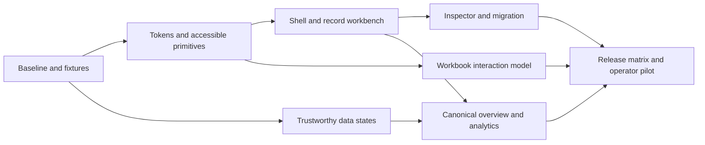

# OpenGTM dashboard transformation work spec

**Status:** dashboard workbench implemented in this branch, including shared Companies/People, import mapping, activation review, adaptive scaling, and source logos. The final merge is subject to combined Go/PostgreSQL/Redis and frontend checks. Production deployment and release publication remain separate work.

**Baseline:** `4375bbdc`, Go-backed local dashboard on port 8002, audited 29 October 2026.

**Audience:** GTM operators and growth teams importing account lists, discovering people, enriching records, and activating qualified audiences.

**Primary job:** move a trustworthy company/person dataset from import to reviewed activation with clear progress, ownership, and cost.

The [evidence-backed audit](../audits/dashboard-ui-ux-2026-10-29/README.md) is the source of current-state findings. This spec defines the target experience and the work required to reach it. “Premium” means coherent, readable, fast, accessible, and dependable at the moment an operator makes a decision. Revenue or valuation is not a design acceptance criterion.

## 1. Outcomes and scope

The transformation must make five tasks feel like one product:

1. Bring a Clay company/people table into OpenGTM without losing identity or custom data.
2. Understand what is known, where it came from, and which values are accepted.
3. Run enrichment with an understandable scope, budget, and recovery path.
4. Review the result, including gaps, conflicts, and changes of employer.
5. Build an audience, monitor companies, and activate people with the existing safeguards.

Retain the Go APIs, authentication, tenant boundaries, durable worker, shared record model, source history, suppression, and delivery deduplication. Preserve existing URLs and keyboard routes during navigation changes. This is a frontend/product-system transformation with a small set of explicit API dependencies, not another backend rewrite.

The first release covers the shell, Companies, People, Workbooks, record inspector, import/export, and trustworthy analytics states. The complete release applies the same system to Audiences, Signals/Watches, Outreach/Campaigns, Sources, Settings, Tasks, and Automations. Login/setup must pass the shared accessibility gates even though they were outside the authenticated visual baseline.

### What the audit establishes

- Twenty token aliases and Base UI wrappers coexist, but component usage and overrides diverge.
- 28 automated route/theme/viewport scans produced 14 rule types and 483 repeated affected-node occurrences. These are not a count of unique defects.
- Primary-action labels fail normal-text contrast in both themes. Source switches and provider reveal buttons lack accessible names. Workbook headers nest interactive controls.
- Analytics turns unavailable requests into zeroes and still displays “Live.” This is the first release blocker to fix.
- The frontend baseline is **69 tests passing, one failing**: navigation expectations omit Companies/People. Repair the expectation while preserving duplicate-route detection.
- Existing theme boot behavior, import-dialog focus containment, virtualized workbook behavior, run review, and useful error recovery should survive the redesign.

## 2. Design direction: a precise GTM workbench

Use a quiet blue/slate palette, clear white surfaces in light mode, and layered blue-neutral surfaces in dark mode. Keep the current recognizable blue brand and mark. Give actions, content, and state distinct visual roles. Reserve stronger color for the primary action, selection, and meaningful operational status.

Use **Manrope** selectively for page/section titles and **Inter** for controls, tables, and body text. This is a proposed font pairing; Manrope is not currently installed. Keep Inter as the heading fallback until the bundled font and its visual metrics are approved. Use tabular numerals for measures and a system monospace only for IDs, code, and technical values. Do not silently switch the main UI face to SF Pro on Apple devices if cross-platform composition is the design target.

The product's signature element is a **record provenance rail** in the inspector: accepted value → source observation → last checked time → review action. It makes OpenGTM's shared-record model visible and useful. It is functional product identity, not another decorative dashboard motif.

Keep the assistant available as a named destination and command entry. The default first-run landing surface becomes an actionable Overview; returning users can reopen their last workbench. The current large chat illustration can remain within the assistant's empty state. It should not occupy the primary operating dashboard.

### Visual rules

- One page title, one dominant page action, and one consistent toolbar hierarchy.
- Three surface levels: canvas, content, elevated overlay. Use boundaries and spacing before shadows.
- No gradient KPI icon tiles, pulsing idle headers, hover-magnifying navigation icons, or blanket zebra striping as default ornament.
- Qualification, provider health, execution state, and destructive state get different semantic mappings. A high-fit person should not inherit the same red treatment as an error merely because the backend tier is named `hot`.
- Use sentence case and user-facing nouns. “Review run,” “Import companies,” “Current company,” and “Accepted value” should mean the same thing everywhere.

## 3. Layout and navigation contract

### Shared geometry

| Element | Desktop target | Responsive rule |
| --- | --- | --- |
| Sidebar | 240px expanded / 64px collapsed | Drawer below 1024px; retained preference above it |
| Global bar | 56px | Workspace context, global search, attention menu; no duplicate page title |
| Page header | 72px minimum | Grows with wrapped title/help; padding 24px desktop / 16px mobile |
| Resource toolbar | 48px minimum | Search stays useful; secondary actions move into a labeled menu |
| Table heading | 40px | Sticky within the table's own scroll region |
| Table rows | 44px default / 36px compact / 52px comfortable | Default at least 44px on touch layouts |
| Controls | 36px default / 32px compact / 44px touch | Glyph size is independent of the clickable area |
| Inspector | 440px at wide desktop | Overlay at 1024–1279px; full-screen panel below 768px |
| Content inset | 24px | 16px below 768px; content can stretch for grids |
| Form width | 560–640px single task | Settings can use wider two-column groups with readable labels |

Do not apply a universal centered max-width to workbooks. Data grids use available width. Overview can cap its inner content at 1600px to preserve grouping on large monitors.

### Resource workbench blueprint

```text
┌───────────────┬───────────────────────────────────────────────────────────────┐
│ Workspace     │ Workspace / Companies                   Search   Attention    │ 56
│               ├───────────────────────────────────────────────────────────────┤
│ Overview      │ Companies                 1,000 accounts       Import company │ 72+
│ Companies     │ Build and qualify your account universe                        │
│ People        ├───────────────────────────────────────────────────────────────┤
│ Workbooks     │ Search companies…   View ▾   Filters    1,000 results   More ▾ │ 48+
│ Audiences     ├────┬─────────────────┬──────────┬──────────┬───────┬────────────┤
│ Signals       │ □  │ Company         │ Domain   │ Fit      │ …     │ Inspector  │
│ Outreach      │ □  │ Acme Robotics   │ acme…    │ High fit │ …     │ Overview   │
│               │ □  │ Northstar Labs  │ north…   │ Review   │ …     │ People     │
│ Operations ▾  │    │                 │          │          │       │ Sources    │
│ Resources  ▾  │    │                 │          │          │       │ History    │
│ Assistant     ├────┴─────────────────┴──────────┴──────────┴───────┴────────────┤
│ Account       │ 1–100 of 1,000                     Previous    Next           │ 40+
└───────────────┴───────────────────────────────────────────────────────────────┘
```

“View” and server-side filters in this blueprint are target capabilities. Do not simulate unsupported filters by filtering only the currently loaded page. Section 9 identifies the API work.

At 390px: a 56px global bar, one title/action row, a useful search input, and a compact labeled overflow menu precede the data. Target the normal collapsed header/toolbar at **200px or less** combined. Table content can scroll horizontally where necessary; the surrounding page and forms must reflow. Keep record identity pinned and make additional columns discoverable with a visible horizontal-scroll affordance. Do not hide actions without an accessible replacement.

### Navigation

Expose Overview, Companies, People, Workbooks, Audiences, Signals, and Outreach as primary destinations. Group Tasks, Automations, and Campaigns under a collapsible Operations group; Sources, Templates, and Analytics under Resources. Keep Assistant directly accessible. Put workspace administration and account settings in their respective menus. Move Legacy leads into a clearly labeled legacy-data destination while preserving `/leads` links.

Keep `/search` available through global search and the command palette. Preserve existing `g` sequences and document any new shortcut; do not steal text-editing or screen-reader commands. Onboarding and explanatory copy should use Company/Person vocabulary consistently.

The shell owns one `<main>`, navigation landmarks, and the skip link. The page header owns the page's H1. The global bar uses breadcrumb/context text rather than another H1. Navigation moves focus to the new page title; in-place edits and background refreshes retain focus. Browser Back restores the prior resource state and position where practical.

## 4. Token system specification

### Three layers, one owner

1. **Primitives:** palette values, spacing, type sizes, radii, timing, elevation.
2. **Semantic tokens:** text, surface, border, action, selection, focus, and operational states, with explicit light/dark values.
3. **Component tokens:** grid row height, sidebar width, field height, inspector width, and toolbar geometry.

The app-owned `--gtm-*` semantic layer is authoritative. Existing `--t-*`, shadcn semantic names, and Tailwind utilities bridge to it during migration. Vendor theme values must not become a second source of truth. Retain compatibility aliases until their callers are migrated.

### Proposed core palette

These are starting implementation values, not a license to add new page-local hex colors. The [machine-readable proposed token contract](dashboard-design-tokens.json) also defines hover/pressed action colors and compatibility aliases. Validate the complete state matrix in context.

| Semantic role | Light | Dark |
| --- | --- | --- |
| Canvas | `#F6F8FB` | `#11151C` |
| Surface | `#FFFFFF` | `#181F2B` |
| Raised surface | `#FFFFFF` | `#1E2838` |
| Primary text | `#15233B` | `#EFF3FA` |
| Secondary text | `#52627A` | `#AFBDD1` |
| Subtle divider | `#DFE5EF` | `#303D52` |
| Required control boundary | `#7B879C` | `#72829B` |
| Primary action fill | `#315BE8` | `#9BB4FF` |
| Primary action label | `#FFFFFF` | `#102044` |
| Link/focus accent | `#315BE8` | `#AFC3FF` |
| Selected surface | `#EAF0FF` | `#243650` |
| Positive text / surface | `#157347` / `#EAF7F0` | `#8ED8B0` / `#17382B` |
| Warning text / surface | `#8A4B06` / `#FFF4DC` | `#F5CB83` / `#3B2E16` |
| Danger text / surface | `#B42337` / `#FFF0F2` | `#FFB1B8` / `#44212C` |

Measured flat-color pairs: proposed primary labels **5.538:1 light / 7.900:1 dark**; primary text **15.725:1 / 14.862:1**; secondary text on the specified surfaces **5.828:1 / 8.681:1**. Required control boundaries are **3.628:1 / 4.239:1** against their specified surfaces. Border colors are not text colors. These calculations do not certify hover, transparency, overlays, or charts; those require component checks.

Use an opaque visible focus indicator with a separating surface gap, rather than relying on a translucent glow. Differentiate focus from selection. A selected row stays visibly selected under hover and on both odd/even rows. Scope table styles to the table component; remove `index.css`'s global `tbody tr:hover td !important` behavior during migration.

### Type, spacing, shape, motion

| Token role | Proposed value |
| --- | --- |
| Page title | 24px / 32px, heading face, 600 |
| Section title | 18px / 24px, heading face, 600 |
| Body and form label | 14px / 20px, Inter, 400/500 |
| Table and compact control | 13px / 20px, Inter, 400/500 |
| Caption/help | 12px / 16px; never the only location of important information |
| Key metric | 28px / 36px, tabular figures |
| Spacing scale | 2, 4, 6, 8, 12, 16, 24, 32, 48px with named tokens |
| Radius scale | 4, 6, 8, 12px; pill reserved for chips/status |
| Icons | 16px controls / 20px section context, 1.75px stroke |
| Interaction motion | 100–160ms color/opacity; 160–220ms overlays |
| Reduced motion | No nonessential stagger, shimmer, pulse, flash, zoom, or automatic slide |

The 12px readability floor and 32/44px product target sizes are product policies, not WCAG's text-size requirements. Implement type in relative units with a normal root size so browser text scaling works. Grid density can be explicit; indiscriminately shrinking every control is not a density system.

Radii must preserve the intended geometry across browsers. The current `@supports(corner-shape)` doubles some values; replace this with documented component geometry or approve separate fallback baselines. Do not assume the same token name produces the same visual shape everywhere.

### Token migration gate

Catalog existing semantic roles, add replacements and aliases, then migrate route families. Gate new code against raw palette utilities, page-local colors, ad hoc font sizes, and direct vendor primitive imports. Allowlist chart series/brand artwork deliberately. Baseline existing debt and require the count to decrease; do not block unrelated maintenance on hundreds of old matches. Publish a component-state gallery for every token change.

## 5. Shared component and state contracts

### Primitive API

Use one public application-owned import boundary: `@/design-system/primitives`. Base UI can remain the interaction engine already used by most pages. Implement compatibility adapters for the existing Twenty compound APIs before replacing their imports. Do not blindly alias Twenty Dialog props to the other Dialog API.

The primitive gallery covers Button, IconButton, Input, Textarea, Checkbox, Switch, Select/Combobox, Tooltip, Menu, Tabs, Dialog, Sheet, Toast, Progress, and StatusBadge. Every control has default, hover, active, focus, disabled, loading, and invalid states in both themes. Forms use a shared Field primitive that connects label, help, and error IDs. IconButton requires an accessible name in its TypeScript API.

An action's loading state preserves width, identifies the action in progress, prevents duplicate requests, and communicates completion. Unavailable actions explain the reason. A tooltip is supplementary help, not the only accessible label or error message. API-key reveal buttons say “Show [provider] API key” / “Hide [provider] API key” and retain focus on toggle.

### Product patterns

Create reusable PageHeader, ResourceToolbar, SelectionBar, DataCollection, RecordInspector, ImportWizard, RunStatus, EmptyState, ErrorState, FreshnessIndicator, and ConfirmationDialog patterns. Product features compose these patterns; they should not each reinvent padding, save behavior, focus, or status colors.

| State | Required presentation and behavior |
| --- | --- |
| First load | Layout-matched skeleton or named status; reserve geometry; no flash of fake zeroes |
| Background refresh | Keep useful data visible; expose refreshing without blocking work |
| True empty dataset | Explain the next meaningful task and provide one primary action |
| Empty search/filter | Preserve the query and offer clear filters; do not invite an unrelated import |
| Unavailable request | Named error, retry, and retained input; no success styling or fabricated values |
| Partial failure | Identify affected items and offer retry only for failures |
| Stale data | Show last successful update time and retry; distinguish from connection status |
| Mutation failure | Preserve the draft/selection, display the error at the relevant control |
| Identity/version conflict | Explain the competing identity/version and offer refresh/review without silent overwrite |
| Permission restricted | Explain the needed role without exposing other tenants' records |
| Running/queued/paused | Distinct labels, scope, elapsed time, and appropriate stop/resume actions |
| Completed execution | Report accepted/rejected/unchanged/failed results, rather than treating worker completion as verified data |

Global connectivity means “Updates connected,” not “Every dataset is fresh.” Analytics freshness comes from successful data responses. For frequent cell results, announce meaningful aggregate progress rather than hundreds of live-region messages.

## 6. Core workflow specifications

### Companies and People

Use one resource-workbench pattern with entity-specific columns and relationships. The default company columns are identity, domain, industry, fit, location, data completeness, and last updated. The default people columns are identity, current company/role, work email with verification state, fit, and last updated. Expose column configuration rather than forcing all fields into a narrow row.

Maintain a pinned identity column and a clearly labeled record-inspector action. The inspector shows Overview, People or Employment, Sources, and Activity. Keep the table context visible when inspecting records; use a focused edit state with Save/Cancel for mutations. Accepted values, rejected observations, and unsaved edits must be distinguishable without color alone.

Selection is explicit: “100 selected on this page” is different from “All 1,000 matching records.” A select-all-query capability requires a backend selection contract. Until that exists, describe the actual selected IDs. Keep selection scoped to the workspace and explain what happens when search/view changes. Never present client-page filtering as dataset-wide filtering.

The resource table can remain a native table with clear headers and a modest number of links/actions. Avoid three separate focus stops for the same open-record action. If spreadsheet interaction is added, adopt the complete grid contract rather than adding `role=grid` as styling. Preserve search, pagination, selected record, and view in a shareable route where supported.

### Record inspector and employment

A person's stable identity sits above the current company and role. Previous employment has a readable chronological history. Changing employer must explain that the person remains the same record; ending employment must be a deliberate action. A role can exist with an unknown employer. Company-owned facts remain visibly associated with the company, even while a person is being inspected.

Each shared field can reveal accepted source, observed time, last update, and alternative observations. “Use value” enters a reviewable draft; saving uses the existing version check. A conflict retains the draft and offers a side-by-side review of changed fields. Custom fields use appropriate text/number/boolean/JSON controls and clear parse errors, not an undifferentiated stack of raw inputs.

### Workbook editor

The workbook header shows the actual workbook title, entity type, scope, saved view, and run status. Keep record names/company links pinned even if a saved enrichment workflow contains only output columns. Keep the useful current run-review and history flows.

Treat the grid as a composite keyboard widget. Maintain one roving entry point; arrows move cells, editing keys enter a cell editor, Escape returns to navigation, and focus survives virtualization. Use columnheader semantics with separate sort, settings, resize, and drag handles; do not turn a parent header containing buttons into another button. Provide logical row/column positions and available totals for virtualized content, including header rows in row counts. Keep sort state and selection exposed. Follow the [APG grid pattern](https://www.w3.org/WAI/ARIA/apg/patterns/grid/) and [virtualized table properties](https://www.w3.org/WAI/ARIA/apg/practices/grid-and-table-properties/).

Keep keyboard resize and add a labeled single-pointer menu for “Move left/right,” numeric width, and column ordering. A keyboard alternative alone does not satisfy the separate dragging-movement requirement. The activity-drawer resize handle also needs keyboard and simple-pointer alternatives.

The run-review surface must answer: which records, which columns/providers, what is already populated, estimated cost/budget, and whether an output action sends data externally. Unknown price is not `$0`. Preserve existing suppression and deduplication behavior. Pending, queued, running, failed, canceled, completed, and partial results must have distinct displays. Inspecting results must not force another provider call.

### Clay migration

Replace the growing all-in-one dialog with a staged task: **Upload → Map → Review → Import → Results**. On desktop it can use a wide task panel; on small screens it is a full-screen step flow. Each step has a clear title, current state, Back/Continue controls, and preserved choices.

- Display the actual file/row/column limits and stable source-table name. Show a small source-data sample, mapping confidence, and destination ownership.
- Group mappings into Company, Person, Employment, and Custom. Detect ignored columns, conflicting targets, identity conflicts, missing identifiers, and precision-sensitive IDs before committing.
- Preview reports rows that will be accepted/rejected and why. Show an indeterminate status with elapsed time when the backend has no progress feed; never invent a percentage.
- Keep the same batch key for uncertain retries. Recovery after reload requires a lookup contract for that attempt; see Section 9. Store only bounded workspace/key/file metadata, not raw contact files or credentials in browser storage.
- Results show accepted, rejected, unchanged where available, and duplicate/replay handling. Provide a downloadable failure report and a direct link to the imported records.
- Offer optional company/person enrichment after import as a separate reviewed action. Import must not start an unreviewed paid run.
- Distinguish **Export table CSV**, **Back up records JSON**, and a full installation backup. CSV cannot recover unexported Clay objects, credentials, or workflow definitions.

### Overview and analytics

Overview answers “What needs attention?” before showing every available chart. Its first screen includes active/recent runs, import problems or records needing review, and shortcuts into Companies/People. Empty workspaces get a short setup path: import companies, connect a provider if needed, enrich a sample, review results.

Use a maximum of four summary measures above the working queue. Proposed measures are Companies, People, verified work-email coverage, and records ready for the selected activation definition. Do not manufacture revenue, attribution, conversion, or “quality” scores without an agreed denominator and source. Hide or label unavailable metrics.

Analytics adds deliberate date range/timezone, entity scope, comparison period where supported, chart labels, table alternatives, and freshness. Chart palettes use semantic/series tokens and a distinguishable non-color cue where needed. Never silently mix historical Lead totals with canonical Company/Person counts.

## 7. Accessibility and responsive acceptance

Target **WCAG 2.2 AA**, with additional product usability requirements. Automated results are one gate; keyboard and assistive-technology testing remain necessary. The [WCAG recommendation](https://www.w3.org/TR/WCAG22/) defines the conformance target.

| Area | Required check |
| --- | --- |
| Text | Normal text at least 4.5:1; qualifying large text at least 3:1; verify all interactive states. [Contrast guidance](https://www.w3.org/WAI/WCAG22/Understanding/contrast-minimum.html) |
| Controls and charts | Required visual cues at least 3:1 against adjacent colors; distinguish decorative dividers from essential boundaries. [Non-text guidance](https://www.w3.org/WAI/WCAG22/Understanding/non-text-contrast.html) |
| Pointer targets | Meet 24 × 24px or a valid exception; product defaults are 32–36px desktop and 44px touch. [Target-size guidance](https://www.w3.org/WAI/WCAG22/Understanding/target-size-minimum.html) |
| Reflow | Surrounding UI/forms work at 320 CSS px without lost content. Two-dimensional grids can retain necessary internal scrolling. [Reflow guidance](https://www.w3.org/WAI/WCAG22/Understanding/reflow.html) |
| Keyboard focus | Visible, predictable, not hidden by sticky chrome; no positive tabindex; skip link works. [Focus guidance](https://www.w3.org/WAI/WCAG22/Understanding/focus-not-obscured-minimum.html) |
| Dialogs | Named, focus enters/contains/restores, Escape works as appropriate, background is inert. Preserve the passing import behavior. [Dialog pattern](https://www.w3.org/WAI/ARIA/apg/patterns/dialog-modal/) |
| Status | Search/import/run results and errors are announced without unnecessary focus changes or per-cell speech spam. [Status guidance](https://www.w3.org/WAI/WCAG22/Understanding/status-messages.html) |
| Dragging | A simple pointer alternative as well as keyboard operability. [Dragging guidance](https://www.w3.org/WAI/WCAG22/Understanding/dragging-movements.html) |
| Names and labels | Visible control wording is included in the accessible name; form labels/help/errors are connected; switches and icon buttons are named |
| Motion and preferences | Reduced motion disables the four confirmed escaping animations and other nonessential movement; test forced colors and text-spacing overrides |

Check VoiceOver/Safari and NVDA/Chrome on the critical journeys. Check browser zoom at 200% and reflow equivalent to 400%, without relying on device emulation alone. Authentication must support password managers, paste, and accessible validation. These checks were not completed by the baseline audit.

## 8. Frontend architecture and implementation rules

```text
src/design-system/
  tokens/          primitive, semantic, and component tokens + compatibility bridge
  primitives/      owned behavior/styling API; adapters hide library differences
  patterns/        page header, toolbar, collection, inspector, task states
  preview/         complete state gallery and responsive examples
src/features/
  records/         queries, schemas, collection, inspector, employment editor
  migration/       upload/mapping/review/result task
  workbooks/       grid, keyboard model, column tools, run review/history
  overview/        typed aggregates and attention queue
  activation/      audience/monitoring/outreach presentation contracts
src/pages/         route composition and route-level boundaries
```

Use the existing React Query setup and typed request boundaries. Add workspace identity to every workspace-specific query key and clear/preserve state deliberately on workspace switch. Abort obsolete reads, preserve server error semantics, and avoid copying server collections into competing local stores. Keep the current lazy routes and grid virtualization.

Extract the workbook editor into cohesive grid, toolbar, selection/keyboard, column settings, and run-status modules as they migrate. Do the same for provider settings, outreach, and automations. Do not split files merely to hit an arbitrary line count, and do not build a universal schema-driven page framework for a handful of distinct workflows.

Use component-scoped state selectors, typed variants, and named domain status mappings. Remove global table hover overrides and route-local token substitutes incrementally. No new `any` at feature/API boundaries; validate external responses before showing success. Unit tests should protect transformations and edge cases; use interaction tests for focus, selection, retries, and mutation feedback rather than implementation-mirroring snapshots.

## 9. API/product dependencies

These capabilities are proposed dependencies, not existing backend promises. Record their contracts before UI work that depends on them.

| Dependency | Required contract | Initial fallback |
| --- | --- | --- |
| Canonical overview aggregates | Workspace-scoped Company/Person counts, verified-email numerator/denominator, defined freshness and time range; optionally readiness after its definition is agreed | Existing record-list totals with explicit scope; unavailable metrics stay unavailable |
| Dataset filtering/sorting/views | Server-side query schema, stable ordering, totals, and pagination; view ownership and invalidation | Ship supported search/pagination only; no page-only pseudo-filtering |
| Query-wide bulk selection | Explicit bounded selection/snapshot semantics with server-side authorization and previewable counts | “Selected IDs on this page,” using existing bounded ID APIs |
| Import recovery | Authenticated workspace-scoped lookup of a completed/in-progress attempt by its stable key; no cross-workspace disclosure | Retry the same in-memory attempt with the same key and clear limitations |
| Data readiness | Agreed definition for fit, verified contact, consent, suppression, and target channel; include rejection reasons | Link to review filters; do not invent a readiness score |

Use the existing schema-version-5 Company/Person/Employment and source-history operations. New presentation must not bypass accepted-field priorities, record versions, consent, suppression, provider pricing, or delivery identity.

## 10. Ordered work packages

Owners are roles, not assignments to individuals. Effort is a planning range in focused engineering days and includes implementation plus feature verification; it is not a delivery commitment. Discovery may change it.

| ID | Priority / owner | Scope and starting files | Depends on | Effort |
| --- | --- | --- | --- | --- |
| UI-00 | P0 / FE + QA | Repair navigation test; commit reproducible read-only audit fixtures/harness and route/state matrix. `tests/navigation.test.ts`, audit evidence | — | 0.5–1 |
| UI-01 | P0 / FE | Correct analytics unavailable/stale/empty states; remove unconditional Live. `pages/analytics.tsx`, analytics hooks | — | 1–2 |
| UI-02 | P0 foundation / Design + FE | Token ownership, contrast pairs, typography/density, radius, reduced motion, state gallery. `tokens.css`, `index.css`, `motion.css` | UI-00 | 2–4 |
| UI-03 | P0 / FE + accessibility QA | Consolidate primitive contracts/adapters; source switches, icon names, fields, focus, touch targets. `design-system/primitives`, `components/ui`, `sources.tsx`, `settings.tsx` | UI-02 | 2–4 |
| UI-04 | P1 / Design + FE | Single header/landmark model, breadcrumbs, nav groups, skip link, mobile drawer, route focus. `App.tsx`, app-shell | UI-03 | 1.5–3 |
| UI-05 | P1 / FE | Companies/People collection pattern, density, identity, selection, toolbar, responsive behavior. `pages/records.tsx` | UI-04 | 2–4 |
| UI-06 | P0 semantics + P1 UX / FE + QA | Workbook header/identity, grid semantics, column controls, resize/reorder alternatives, run/activity states. `workbook-editor.tsx`, workbooks components | UI-03; UI-04 for final layout | 3–5 |
| UI-07 | P1 / Design + FE | Inspector, owned fields, typed custom fields, provenance rail, employer/history, conflict review. `components/records/record-editor.tsx` | UI-05 | 2–3 |
| UI-08 | P1 / FE + optional BE | Staged migration/export/restore, error report, idempotent recovery, mobile task flow. records import/snapshot components | UI-03, UI-05; recovery API if included | 2–4 |
| UI-09 | P1 / Product + BE + FE | Metric definitions, canonical Overview/Analytics, freshness, chart/table alternatives | UI-01, UI-04; aggregate contract | 2–4 FE + 1–3 BE |
| UI-10 | P2 / FE | Apply shared audience/signal/monitoring/outreach/campaign states, scope, confirmation, result receipts | UI-04, UI-05 patterns | 2–4 |
| UI-11 | P2 / FE | Searchable provider/source settings, labeled toggles, tested/saved states, grouped advanced controls, admin roles | UI-03, UI-04 | 1.5–3 |
| UI-12 | P0 release gate / QA + FE | Durable visual/axe matrix, manual keyboard/screen-reader verification, performance budgets | Starts UI-00; grows per package | 2–4 across delivery |
| UI-13 | P1 maintainability / FE | Cohesive feature extraction alongside route migrations; remove duplicate primitives/tokens after parity | Per migrated route | Included in route estimates |
| UI-14 | Release / Product + Design + QA | Operator pilot, regression triage, staged route rollout and rollback review | All P0 and release-scope P1 | 1–2 |

Do not sum these as a fixed calendar promise: phases overlap, API scope is conditional, and the same QA work spans packages. A reasonable planning envelope is **3–5 weeks for the core workbench** and **6–10 weeks for full route coverage**, with one experienced frontend engineer, regular designer/QA support, and limited backend support. Re-estimate after UI-00 through UI-03. Ship the foundation and core workbench as reviewable increments rather than hiding the entire redesign on a long branch.



### Package acceptance checks

- **UI-00:** all 70 existing frontend tests pass; Companies/People routes are asserted exactly once; captured baseline failures remain visible until fixed, with no blanket scan-rule exclusions.
- **UI-01:** injected 503, timeout, and malformed response show unavailable/retry; stale prior data is identified; genuine empty data shows zero; no failure says Live or turns into synthetic success.
- **UI-02:** every documented normal text pair passes; primary actions pass both themes; the four reduced-motion probes return no nonessential animation; no new unapproved palette/type escape enters a migrated route.
- **UI-03:** Sources switches and provider reveal controls are named in the accessibility tree; visible labels agree with accessible names; primitive focus/invalid/loading states pass both themes; Twenty adapters preserve working dialogs during migration.
- **UI-04:** one main and one page H1 per route, working skip link, named navigation, correct active destination; 320px/zoom layout and collapsed/drawer navigation keep all destinations reachable.
- **UI-05:** supported search/pagination totals are honest; selection scope is explicit; selected/hover/focus remain distinct; column identity and row actions are available on desktop/touch/keyboard.
- **UI-06:** no nested interactive headers; a keyboard user can enter, move, edit, resize, reorder, paste, and leave the grid; virtualized indices/totals remain logical across scroll/page changes; person/company identity remains visible in output-only workflows; output reruns still require the existing review safeguards.
- **UI-07:** source review, manual edit, clear field, unknown employer, employer change, end employment, and version conflict retain correct identity/history and drafts; closing returns focus to the invoking row.
- **UI-08:** preview/retry/partial rejection/replay/export/restore journeys preserve mappings and number precision; limits are accurate; uncertain retries reuse the attempt key; no import starts an unreviewed enrichment run.
- **UI-09:** company/person/legacy scopes are explicit and tested; every displayed metric has a denominator/source definition; every chart has a usable alternative; failures and freshness behave like UI-01.
- **UI-10/UI-11:** same status/confirmation/form patterns across modules; external delivery and source changes show correct scope/outcome; hidden/disabled controls respect current role authorization.
- **UI-12/UI-14:** all release gates below pass, documented manual checks are complete, and pilot blockers are resolved before the route family becomes default.

## 11. Verification and release gates

### Coverage matrix

| Dimension | Required cases |
| --- | --- |
| Theme | Light, dark, system; first paint, portals, cross-tab preference |
| Viewport | 320, 390, 768, 1024, 1280, 1440, 1920px; short-height laptop and mobile keyboard |
| Data | Empty, one, 100, 1,000, 10,000 records; long names/URLs, Unicode, multiline values, large IDs, missing employer |
| Network | Slow response, timeout, 401/403/409/422/429/503, offline, stale cache, partial mutation failure |
| Input | Pointer, keyboard, touch, text zoom, forced colors, reduced motion, text-spacing overrides |
| Roles | Admin, editor, viewer, feature-disabled workspace, workspace switch |
| Workflows | Import company → people → enrich → shared edit → audience → reviewed activation; export/reimport and empty-workspace restore |
| Workbook | Narrow/wide columns, hidden/reordered columns, virtual scroll, pinned identity, retained focus/selection, paused/failed/retried jobs |

Use deterministic synthetic fixtures, a pinned browser/OS/font environment, a fixed device pixel ratio, and controlled dates/progress for screenshots. Mask only genuinely dynamic content, not layout, names, errors, or key numbers. Review geometry and state behavior as well as image diffs. A small diff percentage cannot excuse a clipped primary action.

### Hard gates

1. Existing frontend tests, type/build/lint checks, and new interaction tests pass. The current 69/70 baseline is repaired, not hidden.
2. Zero untriaged automated WCAG A/AA violations on the release matrix. Fix measured contrast failures even when a scanner marks a complex background incomplete. Track best-practice findings separately.
3. Keyboard and VoiceOver/NVDA critical journeys pass with recorded results. No visible/actionable content disappears at the agreed zoom/reflow cases.
4. Layout against approved references stays within 1 CSS pixel on key alignments at the pinned test environment; no clipping, stray scrollbars, unstable sticky offsets, or unintended font substitutions.
5. Large datasets retain virtualization/pagination; no redesign downloads all records merely to sort/filter a visible page.
6. Preserve backend integration contracts for shared facts, tenant isolation, consent, budgets, and delivery deduplication. Re-run relevant Go integration checks when request or selection contracts change.
7. Every release route has loading, empty, error, partial, stale, and permission states covered where applicable.

### Performance targets

Measure before optimizing; the audit did not establish production performance baselines. Target p75 **LCP ≤2.5s, INP ≤200ms, CLS ≤0.1**, segmented by device class. Those are field targets; a single local screenshot or Lighthouse load is not a measurement of field INP. [Core Web Vitals reference](https://web.dev/articles/vitals).

For lab regression checks, pin the fixture/network/CPU setup: local sort/selection/open-inspector feedback within 100ms where no request is needed; visible feedback for asynchronous actions within 100ms; no avoidable main-thread stall over 50ms during normal grid navigation. Record p50/p95 over repeat interactions, then set regression tolerances against the measured baseline. Keep charts/assistant/advanced editors in lazy chunks and review bundle changes; do not add a second full UI toolkit.

### Operator pilot and rollout

Run a small moderated pilot with five representative operators, including keyboard-heavy use. Record baseline and redesigned time/error counts for importing a Clay file, reviewing a rejected row, enriching a sample, changing employer, and preparing an audience. Seek completion without facilitator help; set improvement targets after collecting the baseline rather than fabricating conversion gains.

Roll out per route family behind an application flag or staged deployment. Keep old URLs, data contracts, and migrations compatible. Rollback should replace presentation without undoing shared records or execution history. Log only operational telemetry needed for quality measurement; do not place raw CSV contents, contact data, or API keys into analytics events.

## 12. Definition of done

The dashboard transformation is complete when the core journeys look and behave like one system, the measured P0/P1 issues for the release scope are resolved, accessibility/manual checks are recorded, metrics remain trustworthy during failure, and design/code references are maintained together. A palette change, a new landing hero, or a passing screenshot alone does not meet that bar.

## Implementation checkpoint — 2026-10-29

The core workbench is implemented on `feat/dashboard-workbench`. [Repeatable checks and release scope](../testing/dashboard-workbench/README.md) describe the delivered changes and remaining acceptance. This is a core-workbench increment, not a claim that the entire UI-00–UI-14 product program or operator rollout has finished.

The implemented APIs are `GET /api/records/summary`, `GET /api/records/access`, filtered/sorted record listing, detailed current field ownership, and `GET /api/record-imports/{key}` for committed receipts. An absent receipt means unknown/not completed; it is never presented as proof that a batch failed. No new database migration is needed for this UI increment.

The shell preserves existing routes and `g h` for the assistant; `g d` opens Overview. Record search/filter/sort/pagination remain in the URL. The old Twenty compound surface API remains behind the application boundary; its Button/Input adapters now use the same application-owned controls as other routes. Remaining P2 route-specific workflow redesign and further extraction of the legacy workbook module are follow-up scope. Manual screen-reader/browser signoff and the operator pilot remain release requirements.

## Compact workstation direction — 2026-10-29

The user requested a denser overall site with more workstation depth. The current workstation revision supersedes the earlier spacious geometry: 192/52px sidebar, 36px desktop global bar, 44px minimum desktop page header, 40px minimum resource toolbar (41px measured with its border), 32px table headers, 28px compact record rows, 32px standard controls, 28px compact controls, and a 400px inspector. Wide headers place the title and description on one line when space allows. Both text and headers can wrap; touch global chrome grows to 48px. Touch controls retain 44px targets and essential metadata retains its 12px readability floor. Standard/comfortable record rows remain available. Operations and Resources start expanded so the complete toolset is visible.

At the same 1440×1000 viewport and dataset, the initial measured Chromium comparison shows **22 fully visible rows versus 15** in the previous build, with no automated axe violations in either state. Chrome heights: global bar 56→44px, page header 108→64px, toolbar 61→45px, and rows 45→34px. Retest these values after further layout changes rather than treating them as universal screen-density guarantees.

The previous tighter production build showed **24 complete rows at 1440×1000**, versus 22 in the first compact build (9.1% more) and 15 in the original build (60% more). Sidebar collapse now survives a full reload; `[` toggles the rail. Overview and workbook lists use the available width, and audience navigation/detail spacing follows the compact rhythm. These geometry measurements are fixture-specific; workflow, browser and manual gates remain in the completion audit.


The dense workstation revision fits **28 complete company rows at 1440×1000**
against 24 in the immediately preceding build, using the same 1,000-company
fixture. Collection text stays at 13px; standard and comfortable rows remain
40/48px. Coarse-pointer identity and selection controls remain at least 44px.
The shared table primitive uses 13px data text, 32px headings and 4px vertical
cell insets; controls and multiline content can grow rows intrinsically.

Overview metrics form one divided strip, while recent workbooks and imports
share the primary column beside attention/tools. The workbook editor uses two
intentional tool rows with inline title metadata when space allows. Workbook
lists, inspector facts and editing forms use tighter padding without hiding
fields or reducing form-control targets. Local verification and captures are
recorded in [Dense workstation verification](../testing/dashboard-workbench/workstation/README.md).


## Workspace, draft and activation trust implementation — 2026-10-29

The shared leave guard owns route/Back/reload and explicit workspace/sign-out
confirmation for registered editors. Record and instance-provider drafts use it;
provider section changes also request a decision before unmounting their forms.
An in-flight registered save cannot be discarded. Forced session revocation
cancels pending decisions and clears private views immediately. Drafts and tokens
stay in memory, without persisting contact data or secrets in browser storage.

The active workspace used by request headers is bound to each tab's displayed
workspace. Local storage retains the preference for new tabs. A switch in another
tab does not silently redirect existing tabs' requests. The workspace manager
uses the same auth switch, cache clearing and error contract as the shell.

Instance provider controls follow `/auth/me.is_admin`, matching the Go routes'
`RequireGlobalAdmin` policy. Workspace administration does not imply permission
to change instance-wide provider credentials. Failed writes/tests/default changes
retain drafts and show errors. A confirmed provider save settles the edit
baseline independently of a subsequent settings read. Agents settings link to
actual workbook, automation and watch configuration instead of local-only toggles.

Inbound token setup owns rotation review, token memory, paged callbacks and
clipboard/manual-storage acknowledgement. A history error cannot hide a newly
issued token or become a successful empty history. Advertising destinations
require an explicit attestation scoped to the audience and destination type.
External sync/retry/cancel review, the remaining administration forms and all
manual/browser/release gates remain tracked in the completion audit.


## Reviewed audience activation implementation — 2026-10-29

Audience destination actions use a feature-owned workbench. Sync, retry and
cancellation load current audience/destination data, show the target, mapping and
operation semantics, and recheck effective permission and reviewed scope before
submission. Reordered custom field maps remain review-significant because the
backend resolves duplicate target mappings in source order. A changed scope
requires another explicit review. This is a preflight recheck, not an immutable
execution snapshot: sync/retry use membership/settings available when the job
executes, as the interface explains.

A confirmed action receipt is kept before any subsequent read. The shared query
cache also records its latest run, so a failed destination-list refresh cannot
revert the card to “No sync runs yet.” Queued work is distinct from delivered
records; cancellation requested is distinct from cancellation completed. A lost
response requires history review before another submission. Run history uses
20-row cursor pages; delivery history uses 50-row keyset pages and native status
filters. Counts stay scoped to the selected run; loaded receipt counts are labeled
as loaded. Canonical Company/Person links do not manufacture a legacy lead ID.

Membership refresh may enqueue enabled destinations when membership changes.
Refresh, schedule enablement and interval changes therefore review those targets
and recheck the scope. Pausing a schedule explicitly leaves existing sync runs
alone. Refresh receipts represent membership, with a last-confirmed time; external
delivery results are read from destination run history. Registered pending writes
use operation-specific leave-guard labels. Keyboard focus moves to the result
heading after a confirmation control is replaced, and restores to an available
trigger on close.

The Go API adds workspace-scoped `GET /api/audience-destinations/access` for the
effective `activation.write` permission, including explicit member overrides.
Canonical-only delivery rows expose `company_id`/`person_id` with `lead_id: null`;
legacy Lead response shapes stay unchanged even when compatibility aliases exist.
The original parity route/fixture gates remain separate from the explicit Go-only
permission extension and its integration coverage. No schema migration is needed.

Destination creation now has configure/review/receipt across all 12 types, visible labels, guarded per-type drafts, automatic-activation and ad acknowledgements, scope/permission rechecks, exact endpoint inspection, and unknown-response reconciliation without resubmission. Saved configuration never asserts successful external delivery. Evidence and distinct build snapshots are in `../testing/dashboard-workbench/setup/README.md`.

The actual home URL now has an index redirect through authentication; signed-out and signed-in reloads pass in Chromium and WebKit. Native destination inserts explicitly write UTC under every session timezone, with a three-zone regression. Historical timestamps are not rewritten. The remaining activation routes, manual AT, browser/performance/operator and rollout gates stay open in the completion audit.

## Provider settings trust and compact controls — 2026-10-29

Provider key, endpoint, model and default updates now commit together; encryption/write failures leave all fields unchanged. The editor accepts only a receipt for the requested provider, distinguishes refused/unknown outcomes, and reconciles saved model/default values without a new write. Masked keys never establish exact equality. Confirmed receipts settle drafts even if the following read fails. Search/configuration filters keep forms mounted and drafts protected. Explicit discard clears only the selected provider draft, discloses that saved settings remain, and returns focus to its receipt. Testing uses saved settings, discloses usage and clears stale results after edits. Settings now shares the compact heading; controls wrap and grow for readable touch interaction. Evidence and remaining limitations are in `../testing/dashboard-workbench/providers/README.md`. Other administration forms and full release gates remain in the completion audit.

## Collection configuration and concise overview — 2026-10-29

Companies and People now have the specified defaults, with previewable show/hide/order controls, fixed pinned identity and user/workspace/type-scoped preferences. Core-fact coverage is explained per record without implying verified accuracy. Verification status accepts structured results; company links resolve actual canonical identity, and unknown employers are plain text. The overview keeps numeric scope/freshness and errors while removing repeated explanations and promoting compact actions. Native large-data, focus, browser-preference and rendered evidence is maintained in `../testing/dashboard-workbench/collections/README.md`. Remaining lifecycle, manual accessibility, performance and rollout gates remain authoritative in the completion audit.

## Import mapping implementation — 2026-10-29

File inspection now precedes row preview, so duplicate suggestions can be repaired
before validation. The feature groups destinations by ownership, shows exact
source samples and match provenance, preserves typing focus during remapping, and
keeps source/mapping immutable during an uncertain import. Receipt recovery is
validated and read-only, including after reload; storage failures are explicit.
Results link accepted records and offer selection for separately reviewed
enrichment without starting a provider run. The compact mobile task retains its
footer, touch targets and leave protection.

[Import verification](../testing/dashboard-workbench/imports/README.md) records
the native browser journeys and the unresolved 10,000-row integration timeout.
The original transformation scope and release gates remain unchanged.
